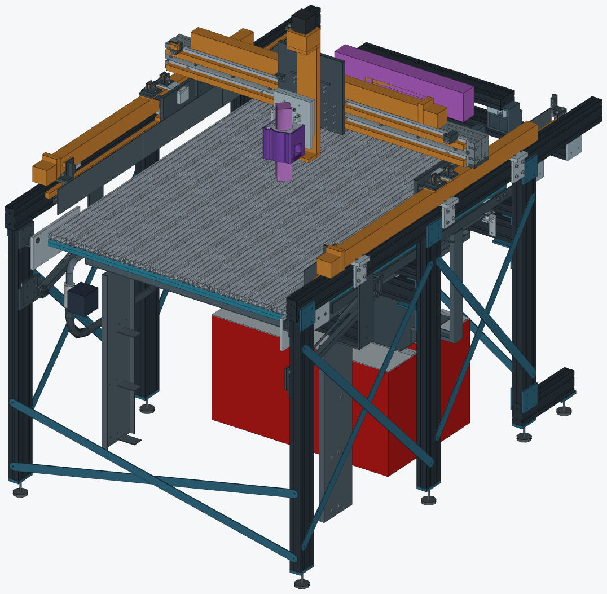
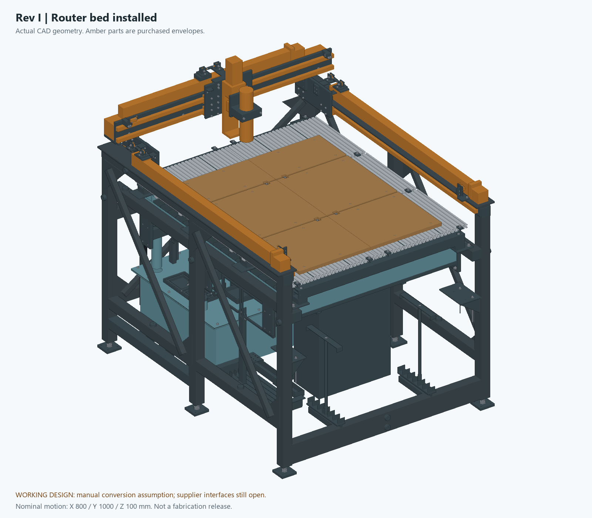

# Plasma / router CNC stand

**Current small machine: [integrated 4080 design](variants/integrated-4080-small/README.md).**
It now combines the owner's original head geometry, full HDPE/20100 bed,
owned 300 mm Z and selected retractable magazine slide in one source assembly.
It replaces the earlier provisional head and cassette-bed candidates.

**Review CAD only: fabrication/CAM release and the USD 1000 delivered budget do not pass.**
Read the [current status](variants/integrated-4080-small/STATUS.md) and
[stock, ownership and cost register](variants/integrated-4080-small/manufacturing/README.md).
Known owned motion, guides, drives, spindle/VFD and working head are excluded
from new costs. The currently sourced tracks, HDPE and Basic ATC alone extend
to $1025.70 before the frame, pan, hardware and delivery charges. The exact
AliExpress hardware additions are recorded separately in the current
[cart evidence](variants/integrated-4080-small/manufacturing/selected-cart-evidence.json);
that partial cart is not a full-build quote.

- [Wood-mode STEP](variants/integrated-4080-small/output/INTEGRATED_4080_SMALL_WOOD.step)
- [Plasma-mode STEP](variants/integrated-4080-small/output/INTEGRATED_4080_SMALL_PLASMA.step)
- [Assembly and STEP readback](variants/integrated-4080-small/output/assembly-check.json)
- [Current subsystem clearance evidence](variants/integrated-4080-small/output/integration-clearance-check.json)
- [Printable current review](output/pdf/plasma-router-stand-integrated-4080-review.pdf)
- [Variant index and separate 4x8 studies](variants/README.md)

The full 1000 x1220 mm bed tilts into a permanent front parking bay; the ATC
parks in the rear bay. The six-post 4080 frame uses a paired-4080 gantry and a
third pan bearer. Source geometry checks are distinct from actual supplier
interfaces, physical rigidity, safe handling, controls and a delivered quote.
Purple spindle/boot/magazine context must not be used as verified installed
vendor geometry. The complete machine is not qualified for steel milling.

Historical packages and prior design notes

# Plasma / router CNC stand

**Not finished or fabrication-ready. [Current status](variants/owned-z300-assessment/STATUS.md)**
records the remaining owner-head, continuous HDPE/20100 bed and magazine-slide
integration work. The current proposal uses provisional alternatives for those
items; its passing geometry checks do not establish requirement completion.

**Current integration candidate: [owned RATTMMOTOR ZBX80, 300 mm stroke, on the 4080 table](variants/owned-z300-assessment/README.md).**
The recovered purchase record already identified this unit. The candidate keeps
800 mm X / 1000 mm Y and assesses 200 mm of working Z; the full 300 mm operating
domain is not qualified. It retains the gantry height and carrier outer blank.
Corrected carrier/flange clearance and lower support taps are included in the
review assemblies, along with matched front-stop/motor-envelope relief and
relocated forward mounting holes. The proposed new 200 mm Z purchase remains excluded.

**Frozen source baseline: [XR2 — re-engineered 4080 wood/plasma table](variants/extrusion-reengineered/README.md).**
Its whole-machine STEP and fabrication files retain the earlier 200 mm Z and
the inherited custom-joint defects documented in the new candidate. Use the
new proposal and repair files when reviewing the owned-Z300 integration.
This replaces the previous extrusion-table and cart proposals for the user's
current build. The complete mechanical-table budget is capped at USD 1,000;
pricing and shopping are paused until the engineering review is complete.
Owned motion, guides, drives and spindle/VFD are excluded from future purchasing.
The XR2 package has its own geometry, checks and physical-interface holds.
Its budget is a constraint, not a verified delivered quote. It is not a steel-milling qualification.

Earlier CAD, prices, carts, lead values and test results below are historical
and must not be transferred to XR2. The 4x8 and ATC studies remain separate;
they have not been silently incorporated into this small-table budget revision.

**Preserved baseline: Rev I.** It adds a floating/breakaway head mechanism,
stronger storage restraints, supported plumbing and defined water/tool control
circuits. It is still an engineering design with open measured interfaces and
integration work, **not a fabrication-ready or operational machine**.

**Separate ATC development:** [retractable ATC mechanisms for both machines](variants/retractable-atc/README.md),
with 200 mm slide travel, automatic pin release and onboard Kraken drive
allocations. The small-machine proposal includes a longer Z configuration;
the 4x8 uses a separate side bay. These have their own CAD, controls model and
checks. Exact magazine interfaces and machine qualification remain open.
Use the [variant index](variants/README.md) to distinguish these proposals from
the preserved Rev I baseline and earlier fixed-dock studies.

## Open the current design

- [Current status, required owner integration and remaining design work](variants/owned-z300-assessment/STATUS.md)
- [Latest owned-Z300 review and checked candidate parts](variants/owned-z300-assessment/README.md)
- [Current XR2 4080 small table, engineering before pricing](variants/extrusion-reengineered/README.md)
- [XR2 printable design and audit review](output/pdf/plasma-router-stand-XR2-review.pdf)
- [Historical welded-table budget study and simulations](variants/whole-table-600/README.md)
- [Earlier reinforced nine-foot table study](variants/budget-hybrid-600/README.md)
- [Latest small and 4x8 retractable ATC work](variants/retractable-atc/README.md)
- [Baseline Rev I CAD package and limitations](output/release-review/RevI-CAD/README.md)
- [Baseline router assembly STEP](output/release-review/RevI-CAD/step/RevI_ROUTER.step)
- [Baseline bed stored assembly STEP](output/release-review/RevI-CAD/step/RevI_BED_STORED.step)
- [Plasma head hardware STEP](output/release-review/RevI-CAD/step/RevI_PLASMA_HARDWARE.step) — measured torch not yet installed
- [Preserved pre-XR2 concept PDF](output/pdf/plasma-router-stand-concept-before-XR2.pdf)
- [Changes, evidence and reproduction](output/design-finish-2026-09-26/README.md)
- [Baseline verification index](output/design-finish-2026-09-26/ACCEPTANCE.md)
- [Every original audit finding](output/design-finish-2026-09-26/FINDING-DISPOSITION.md)
- [Remaining engineering and measured inputs](output/design-finish-2026-09-26/OPEN-ITEMS.md)
- [Mechanical component schedule](output/release-review/RevI-CAD/cutlist.csv)
- [Selected controls schedule](output/design-finish-2026-09-26/controls/selected-components.json)
- [Scrap tube lengths and inspection inputs](output/design-completion-2026-09-26/SCRAP-TUBE-GUIDE.md)
- [X/Y lead check and arrival measurements](output/design-completion-2026-09-26/CONTROL-SCALE-CHECK.md)

The view above is the Rev I baseline. The [latest retractable ATC package](variants/retractable-atc/README.md) contains the new small and full-sheet machine views and STEP files.

## Design and changes

Ten 1220 mm extrusion bars yield thirty 397 mm strips in six 500 × 397 mm
panels. The bare bed is 1003 × 1211 mm. Panels, four support beams and separate
spoilboards store inside the chassis. Conversion is manual and retains 52
primary release fasteners plus restraint/tool operations. It is not an
automatic or quick bed changer.

The head now has twin guides, 6 mm captured float, cone/V/flat magnetic release,
sealed detection switches, machined clamp features and internal parking. Its
replaceable insert remains unbored until the actual torch is measured. The
plasma hardware view is therefore a mechanism assembly, not an invented
ready-to-cut VIV ARC CUT-50 setup.

Storage rods increase from 10 to 14 mm with 40 mm sockets and thicker seats.
Actual-section calculations replace the earlier incomplete stiffness claim.
The proposed light-routing target is 0.20 mm tool-to-work displacement at
100 N; known bed members alone account for about 0.135 mm. Actual motion,
mount, joint and tool compliance remain unqualified. Sand receives no
elastic-stiffness credit.

The water system gains a supported drain/flange, removable tail and parking
cup, strainer carrier, corrected pump orientation and supported pressure and
suction hose routes. The reservoir stays vented. A compressor or venturi is
not connected to the fabricated tank.

[Current controls](output/design-finish-2026-09-26/controls/README.md) retain
Kraken V1.1 with onboard drivers. Actual terminal circuits, timer contacts,
isolated run request, restart prevention and a selected C41S speed converter
are defined. Separate [isolated head inputs](output/design-finish-2026-09-26/controls/HEAD-INTERFACE.md)
connect the float and breakaway switches. Router Z zero remains manual; the
parked plasma float is not a spindle touchplate. The populated panel, complete stop/power/brake system, actual
VFD/cutter interface and physical commissioning remain unfinished.

The selected X/Y catalog variants specify **10 mm lead**, meaning movement
per screw revolution, not screw diameter. The selected SFU1605 Z has 5 mm
lead. Verify delivered modules before final calibration and adapter drilling.

The 2 × 2 tube list remains 30 blanks totaling 29,472 mm / 96.69 ft net, using
3.048 mm modeled wall. Actual scrap lengths, remaining wall and condition
must be recorded before nesting. The mechanical cut list is not a complete
electrical BOM or a current delivered purchase total.

## Evidence, history and cost

The [verification index](output/design-finish-2026-09-26/ACCEPTANCE.md) binds
current assembly, pose, route, service, mechanism, circuit and export reports
to their source files. These checks have explicit limits: nominal clear
geometry does not establish physical rigidity, force thresholds, operator
access, live electrical behavior or machining accuracy.

The active generator is [build_revi.py](output/release-review/RevE-ENGINEERING/build_revi.py).
Shared Python sources retain their legacy directory name; **current exports
are in RevI-CAD**. Rev H, Rev G, older exports and the
[29-finding audit](output/cad-reaudit-2026-09-25/README.md) are preserved as
historical evidence. They are not relabeled as current results.

[Earlier prices](outputs/reve-30510/CNC-plasma-RevE-budget.xlsx) and the
[actual-price audit](outputs/reve-30510/actual-cost/REAL-COST.md) are historical
procurement research. Quantities changed; neither is a complete Rev I build
total. No purchase, vendor message, firmware flash or machine operation is
implied by this public design record.

CadQuery/OpenCascade generate exchange geometry; ReportLab generates the
concept brief. This is not a native Fusion feature-history or machine-specific
CAM release. The [original snapshot manifest](REPOSITORY-SNAPSHOT.json)
describes the initial import only. Supplier material retains its existing
license notices; this repository grants no new rights over it.

