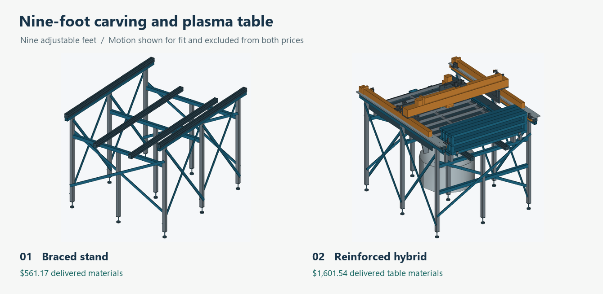

# Reinforced nine-foot carving and plasma table

Review variant for the small 800 × 1,000 × 100 mm machine. Nine adjustable floor feet support a welded steel frame. Both tooling states reuse the selected motion envelopes and the continuous 4040 upper rails. The fabrication and CAM release remains on hold.

## What the price covers

| Scope | Delivered materials estimate, including 7% tax |
|---|---:|
| Braced stand, nine adjustable feet and four 1,500 mm 4040 bars | **$561.17** |
| Reinforced stand with both beds, 12-gauge pan, ten slats, shields, rail-interface stock, removable carriers, backers, manual drain and receiver | **$1,601.54** |
| Previous nine-foot 19-slat design with both beds and the priced near-gauge stock | **$2,089.97** |

The complete revised estimate consists of $1,062.77 of goods, $434.00 of shipping and $104.77 of estimated tax. The $12 plumbing parcel is an allowance. The two large steel rates use destination estimates. Liftgate service and some small-parcel checkout rates are unconfirmed. Shop labor is supplied by the fabricator. Welding wire, gas, abrasives and finishing supplies are outside the cash estimate, as are motion, controls, extraction, tooling and automatic recirculation. The takeoff charges no replacement cost for the owner's small aluminum blanks. Inspect the alloy and usable area before allocating any of them.

The $600 ceiling leaves $38.83 above the stand materials. The complete design exceeds the ceiling by $1,001.54. Replacing **all** process/frame steel, rail caps and datum bars with dimensionally suitable local stock would require an all-in metal quote of **$121.85 or less before tax** to hit $600 with the other purchases unchanged. Both metal orders currently total $1,057.88 delivered before tax. The estimate is for raw material and fabricated-in-house parts.

## Load paths and accuracy

- Two 1,450 mm motion rails bear on continuous steel backers. Three crossframes carry the wet bed, each with its own center foot. All side bays and both ends are cross-braced. The raised side anchors and lower end anchors clear the steel pan.
- Independent dry-side ledgers carry four lift-out steel frames with removable MDF. Three closed rectangular crossbars per carrier stand 50.8 mm tall. Welded webs deepen the ledger between supports and reinforce the carrier storage shelves.
- At an assumed 100 N vertical load, the reinforced dry-bed calculation gives 0.140 mm work-side movement above a bar or 0.131 mm between bars at a 906.6 mm bearing span. On that same span, bar-only movement fell from 0.606 mm with the shallow section to 0.111 mm with the deeper section. The final storage clearance change moved each ledger inward 20 mm and shortened the span to 866.6 mm. Full tool-to-work movement includes the head, gantry, guides, joints and workholding. See [static simulation, loads and material assumptions](simulation/README.md).
- In the 100 kg wet-load case with unequal load on the pan stringers, a middle crossbeam moves 0.109 mm with its center foot engaged. Removing that support raises predicted flex to 2.291 mm. Level all nine points at operating water level and measure the rail and bed datums with an indicator referenced to the work.
- The inherited 100 mm Z travel is a mechanical envelope. The revised backer is at **Z983.5**, 24.7 mm above the original nominal backer. The reviewed spindle-body range uses a minimum 30 mm lift, leaving 6.5 mm over the bare backer for that body. Actual cutter length, work thickness and clamps set new work offsets and soft limits for every setup.

## Bed change and working envelope

Four steel carriers load upright into the elevated rear rack. Remove the MDF and clamps first. The transfer study uses the spindle with no installed cutter, gantry Y275, head X575 and Z lift 100. It takes the rear panel to the rear slot first. An M5 hold-down per parked carrier passes through a shelf lug into a steel doubler. Remove the hold-downs before restoring the dry setup in reverse order. The motion study checks rigid solids and modeled floor space. A physical dry run must establish room for hands and leads, secure retention and safe handling of approximately 5 kg per carrier. [Transfer study](transfer/transfer-evidence.json)

The raised rack forces a shorter plasma Y limit. The original rear position drives the Z stage into the stored carriers. The review limits cap the plasma gantry at Y1240, equivalent to nominal torch axis Y1038.6. As a planning example, a 15 mm inset from the outer slat edges gives about 794 × 945 mm of supported cutting area after this limit. Real workholding, nozzle and a narrow or flexible workpiece can reduce it. Travel settings have not been written to a controller.

## Wet process and clearance

The 830 × 1,030 mm pan floor and ten 824 × 30 mm transverse slats nest on one 48 × 48 inch sheet. The ten slats are on 108.5 mm centers. Narrow blanks and offcuts need additional support. The pan only contains water at atmospheric pressure. Set the reference water surface 34 mm above the low end of the inside floor. The overflow crest is 39 mm above that floor. The calculations for a 43 mm water level cover an overtopped crest. A 0.5% floor slope points toward the drain box. The receiver size, slot, valve, screens, runoff and independent overflow require measured flow and leak tests with clean water before hot work.

Two open steel chutes are allocated separately. A shop-fabricated drop box connects the low wall opening to a nominal 1-inch threaded outlet. The CAD contains the nipple envelope. Valve thread engagement, installed handle sweep, splash capture and removal access require the selected physical fittings. Keep the receiver permanently vented. Keep wood and dust gear out of the hot bay and segregate fume capture and protective bonding. The steel table provides no verification of CUT-50 start, THC, stop circuits, Z retention or arc interference with controls.

## Review files

- [Braced stand](review/STAND.step), [carving setup](review/CARVING.step) and [plasma setup](review/PLASMA.step)
- [Exact solid intersections and STEP round-trip counts](review/geometry.json) and [tool-body travel check](review/travel.json)
- [Static beam, rack, load, thermal and support calculations](simulation/results.json)
- [Dynamics, buckling and tipping sensitivity](simulation/DYNAMICS.md) and [water capacity, drain paths and cold-water tests](review/water-check.json)

The two STEP files are for dimensional review. They omit supplier internals, weld beads, individual threads, real cable motion and selected cutter/torch geometry. Source stock and bend allowances, fixture and rail flatness, actual foot contact, weld sizes and distortion, thermal shielding, emergency stops, failure on loss of power, dry dust clearance, extraction and return-current routing require shop verification. Do not generate production toolpaths from this candidate.
