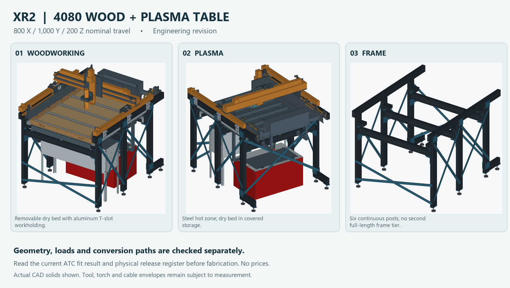

# XR2 - 4080 woodworking / plasma table with retractable ATC

This is the current small-table design: **800 X / 1000 Y / 200 Z mm nominal travel**.
The user selected full-bed ATC and authorized a different Z unit. The original
100 mm Z is superseded; the new 200 mm replacement is not assumed owned.
Existing X/Y motion, matching guides, drives, spindle/VFD and the electronics
enclosure remain owned.

**Engineering design and CAM preparation, with physical release gates.**
The **USD 1,000 delivered complete-table cap remains unverified**. No new prices
or cart changes were made during this revision. Include all unowned ATC and
replacement-Z hardware in the next complete-build total.



## Current files

- [Woodworking assembly](review/XR2_WOOD.step)
- [Plasma assembly with dry cassettes stored](review/XR2_PLASMA.step)
- [Frame](review/XR2_FRAME.step)
- [ATC deployed with head at safe transport park](review/XR2_ATC_DEPLOYED.step)
- [Separate supplier kit/tool acceptance-volume layout](review/XR2_ATC_ACCEPTANCE_LAYOUT.step)
- [Printable design and audit review](../../output/pdf/plasma-router-stand-XR2-review.pdf)
- [Machine-readable evidence index](review/package-check.json)
- [Audit and physical release conditions](AUDIT.md)
- [Bed construction and conversion](BED.md)
- [Water, clean-out hatch and service](WATER.md)
- [Motion, mounted shielding and supplier interfaces](INTERFACES.md)
- [ATC mechanism and redesigned Z](ATC-INTERFACE.md)
- [Custom-part STEP pack and reference DXFs](fabrication/README.md)
- [Setup datums and CAM surface references](CAM-SETUP.md)
- [Blank measurement worksheet](MEASUREMENTS-BLANK.csv)
- [Requirements and ownership](requirements.json)

## Structure and independent beds

Six posts carry two 1450 mm headers. Short rear 4080 bases add rear feet at
Y1410, giving eight main feet. Three strong-axis crossmembers carry the pan;
short flat arms and aluminum ledgers carry the dry bed separately. Direct
bearing carries gravity loads. Fishplates and paired steel tension straps
resist racking. The main frame has **19 cuts totaling 12.3574 m of 4080**.

The extrusion model establishes mounting envelopes, not actual section
properties or slot capacity. Required properties and sensitivities are in
the structure report. The stock nests include saw gaps and trim, without
assuming a vendor's pack quantity.

The joint steel nest combines **94 nominal 1.9 mm blanks** for the pan,
shields, cabinet, straps and ATC. The checked rectangular-blank layouts use
two 4 x 8 ft sheets or one 5 x 10 ft sheet, with 3 mm kerf and 5 mm edge trim.
Other gauges, bars and hollow sections remain separate stock. This is a
feasible stock layout, not an optimality proof or a delivered quotation.

Two integral billet gantry corners and six integral clevises retain the user's
billet preference. The two owned 12-inch aluminum blanks are allocated once
in a checked **83-blank nest**, including eight small cabinet tabs/blocks.
Deep billets and unlisted parts remain new stock.
Six accessible actuator saddles replace the old continuous steel caps.

Four **932 x 257 x 70.8 mm** dry carriers have separate half-lapped ribs,
12.7 mm plywood skins, a 39.05 mm core and 6.35 mm replaceable MDF wear pads.
Metal datum pads, round/diamond location and independent hold-downs establish
repeatable docking. Aluminum T-slot tracks remain. The **770 x 960 mm enclosing
wear field** has track, seam, screw and clamp keep-outs; it is not one clear slab.

The fixed plain-steel pan is **894 x 1096 mm outside**. Eight center-keyed
880 mm slats sit on three combs. Center keys limit walk while leaving the ends
free to expand. Pan ears provide positive capture with thermal float.

## Conversion, guards and water service

Bed conversion stays inside the modeled plan. Remove the complete installed
spindle/clamp or plasma drop/head/torch assembly, cassette clamp sets and
plasma-only ledger armors. Retain Z, park at the specified transfer pose and
keep ATC parked. Refit the next tool module after conversion. Permanent guide
guards stay fitted. The transfer report covers the complete segment enclosures;
human clearance and actual handling loads require a trial.

Mounted plain-steel guide guards, ledger armors and a receiver roof replace
the disconnected shadow strips. The receiver roof has two thicker mounting
brackets to control gravity sag. The guards are nonsealed and do not provide
fume extraction. Protected wood storage requires actual thermal testing.

The selected red box is the **drain-water reservoir**, not the electronics
enclosure. It stays atmospheric with gravity drain and independent overflow.
A metal-supported, lock-open clean-out hatch permits routine cleaning without
hinging the whole lid or removing the tank. Rare tank replacement has its own
disassembly/handling sequence. Verify **65 L measured usable capacity** and
actual liquid-load/temperature suitability. Nominal storage volume is not a
liquid rating. The CV-15HS is not used as a liquid pump.

## ATC and Z

The carrier has **200 mm travel on finished 335 mm guides cut from 350 mm blanks**. It includes its supporting
load path, removable carrier, hard location, endpoint retention and protective
parking. Manufacturer magazine/tool acceptance volumes are distinct from
verified supplier geometry; the actual kit/nut/pocket interfaces remain to verify.

The selected nominal replacement is **RATTMMOTOR ZXHT80-200 / B09MYD6Z23**:
200 mm stroke, 319 mm body and 430 mm overall package in the primary drawings.
The module's low output datum is retained. The spindle's nominal axial setup
is10 mm higher in its existing clamp, with modeled reference Z970..1170.
The checked case uses up to50 mm loaded-tool projection and up to26.35 mm
retained projection below the magazine base over40 mm combined stock/clamps.
Actual gripping limits, nut planes and tool envelopes still require confirmation.
The stock-motor package is430 mm overall; the conditional brake-motor provision
adds32 mm behind the motor's front datum. The source record separates verified
dimensions from omitted output, coupling and retention details. Use the current ATC report for the modeled stock,
clamp and tool limits. No automatic M6 cycle is claimed qualified.

## Evidence and manufacturing

Checks separate valid solids and STEP read-back, external travel, continuous
bed transfer, shield/service paths, ATC mechanism/reach, stock nesting and
nominal component calculations. The **0.30 mm at 100 N** framework/bed target
is not measured complete spindle-to-work accuracy. The half-lap calculation
is a nominal sensitivity with local joint/adhesive compliance omitted.
This version is for woodworking and steel-sheet plasma; steel milling is
not qualified.

Individual custom STEP files preserve current nominal geometry. Plate files
labeled MIDSECTION_REFERENCE are cross-sections, not complete machining
drawings. Counterbores, countersinks, edge holes, taps and bends require the
STEP and matching notes. Bed, shields and ATC have separate fabrication
schedules and flat files. No production G-code is supplied.

Freeze geometry and parameters before regenerating reports. The package
index checks source and output hashes, including custom STEP and reference
DXF files. Runtime dependencies are CadQuery 2.7, NumPy, Pillow, VTK and ezdxf;
the PDF uses ReportLab and pypdf. CAD scripts exit explicitly around the
known local OCCT interpreter-teardown defect.

Regenerate from this directory with the same frozen sources. Run these in
order; a nonzero exit or a false check is a failed check, not a release:

```powershell
python structure_screen.py --fabrication
python cutplan.py
python check_owned_stock.py
python bed_screen.py
python bed_fabrication.py
python bed_takeoff.py
python audit_motion.py --manifest
python shields.py --check
python atc_fabrication.py
python manufacture.py
python cam_reference.py
python release_register.py
python build.py
python check_travel.py
python review/check_internal_continuous.py
python check_atc.py
python check_atc_capacity_field.py
python atc_stiffness.py
python atc_tab_update_audit.py
python check_transfer.py
python service_check.py
python water_check.py
python render_details.py
python steel_nesting.py
python audit_package.py
python create_review_pdf.py
python audit_package.py
```

Render and inspect all four PDF pages after regeneration. The package index
also records the PDF hash; it does not turn the physical release flag on.

Earlier XR1, Rev I, 4x8 and ATC studies remain historical or separate work.
Their prices, firmware, screw leads and test results do not transfer to XR2.
The old Amazon cart remains superseded.
