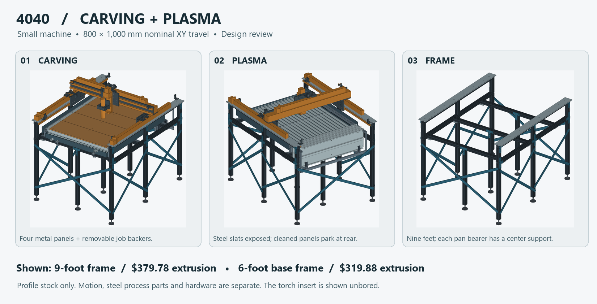

# 4040 carving and plasma table

**For the small 800 mm X / 1,000 mm Y / 100 mm Z machine.** This alternative uses Amazon T-slot aluminum profiles for the chassis, the small machine's existing motion selection, and manual tool/bed changes. It is designed around wood carving and plasma-cutting uncoated mild-steel sheet. It does not carry the other variants' steel-milling requirement, ATC mechanism or automatic-tool-change budget. Those designs remain separate.

## What to buy for the extrusion

| Configuration | 4 × 1,500 mm packs | 4 × 1,000 mm packs | Extrusion before tax |
|---|---:|---:|---:|
| Six-foot base chassis | 2 | 1 | **$319.88** |
| **Nine-foot chassis shown in the complete models** | **2** | **2** | **$379.78** |

The long stock is [SERABETTO black 4040, four × 1,500 mm](https://www.amazon.com/dp/B0DCP25CYB?th=1&psc=1), $129.99 per pack. The short stock is [VEVOR black 4040, four × 1,000 mm](https://www.amazon.com/dp/B0F47JQ9K6?th=1&psc=1), $59.90 per pack. On October 31, 2026, the public item pages showed free standard delivery to Alto, GA 30510. Availability, multi-pack checkout, tax and final delivered total can change. The extra pack supplies three center legs and leaves one full short bar. It leaves **$20.22** under $400 before tax, versus $80.12 for the base. See [offers, delivery notes and remaining metal](SOURCING.md).

**What this costs beyond the bars:** using the [priced Amazon slot nuts and candidate screws](FASTENERS.md), the six-foot version is **$433–434 for profiles + those fasteners**, or **$511–512 for nine feet** (rounded, before tax, shipping on hardware or washers). These are examples, not the cheapest possible prices or a completed chassis quote. The steel water pan, combs, slats, steel dry-bed carriers, brace straps, rail caps/datum bars, feet and connection plates still cost money. Motion, spindle, plasma power supply, dust/fume handling, electrical equipment and water-handling equipment are separate. The owner’s 12 × 12 inch stock is useful for short parts, including the ½ inch plasma tool plate. It cannot supply the long caps and rails. Get one local steel quote against the actual sizes before comparing with the $1,000 metal figure; the [sourcing sheet](SOURCING.md) includes a slat stock example and regional quote sources.

## Frame, bed and usable area

The base uses four **1,450 mm** side rails, three **1,048.4 mm** continuous crossmembers, six **730 mm** legs and six **176.5 mm** upper posts. One long bar yields a crossmember and two upper posts. The [base cut plan](stock-and-cuts.csv) includes end cleanup and 3 mm saw kerf. For the wet-supported version, add three more 730 mm legs following the [extra-pack cuts](extra-pack-9-feet.csv). All posts bear on end faces. Bolted exterior plates tie the two side tiers together; underside shelf plates join the crossmembers. Both end planes and both side bays have opposing steel tension straps. The modeled profiles have schematic grooves; their volumes **do not** represent real aluminum mass or inertia.

**Why I favor the three extra supports:** the pan, steel slats and their supports weigh about 42 kg dry and about 80 kg at normal water level. With the other bed parts, parked bridges and water, the load is about **114 kg before a sheet, frame or gantry**. Each extra foot sits directly under a crossmember. Under the same uniform line load, shortening a simply supported 1,088.4 mm span to two 544.2 mm spans reduces ideal member sag by a factor of 16. It requires all feet to bear properly on the floor. The [support calculations](review/support-screen.json) give the necessary section inertia under stated load divisions; neither seller supplies certified joint stiffness or the profile inertia used to release this machine. The calculated ratio is not a full-machine prediction.

| | Carving setup | Plasma setup |
|---|---|---|
| Work surface | Four removable 932 × 257 mm steel bridges; 826 × 255 × 12.7 mm job backers | Nineteen replaceable steel slats over a fixed, sloped 894 × 1,132 mm pan |
| Working rectangle | Nominal 800 × 1,000 mm tool-center travel; clamps, backer gaps, screws and tool diameter affect the actual job | **800 × 963.6 mm proposed** after the front slat margin and actual head offset, before clamps and nozzle qualification |
| Changeover | Four hold-downs per bridge; a round/relieved locator pair returns each panel to the dry side rails | Remove the wood and dust equipment, then store the four cleaned metal bridges vertically behind the pan. Each one is about 4.9 kg. No front cart or loose MDF in the hot bay. |
| Tool | Existing 65 mm spindle layout and a measured cutter/fixture setup | Removable lowered floating/breakaway head, with an unbored insert for the actual torch |

The steel pan carries the hot work. The carving bed has a separate support path into the chassis. Protect exposed aluminum, keep the actual work lead on the retained steel work, and provide appropriate protective bonding. Isolate woodworking dust collection from the plasma fume system. **The owner-reported VIV ARC CUT-50 / AG-60-like combination has no verified CNC start/height interface here.** There is no live plasma controller configuration, guessed cutter pinout or thickness rating. The [bed and changeover details](BED-MODES.md) and [head and motion details](MOTION.md) explain the checks and outstanding measurements.

## Open the CAD

- [Complete carving setup — STEP](review/WOOD.step) and [complete plasma setup — STEP](review/PLASMA.step). Both use the nine-foot frame. These millimeter STEP assemblies import into Fusion. Neither contains machine-ready CAM.
- [Frame only — nine feet](review/FRAME_9_FEET.step) or [six feet](review/FRAME.step). These isolate the extrusion/brace construction for quoting and review.
- [Frame hardware takeoff](FRAME-HARDWARE.md) and [36 plate/brace DXFs indexed for quoting](plate-profiles/index.csv). These are 1:1 millimeter outlines for the components in the STEP. Verify fits, bends, fastenings and machining allowances before producing parts.
- [Frame and both modes at a glance](review/overview.png), [carving view](review/wood-view.png), [plasma view](review/plasma-view.png), [named component inventory](review/component-index.csv).
- [Optional vented drain/refill layout](WATER.md). The main frame/bed exchange files stand independently of this option. The pan itself has a low-point drain and a separate overflow.

## Before releasing parts or running either mode

1. Compare a real nut and offcut from **both brands**. Verify slot lip, channel, bolt length, preload and bearing, and inspect straightness. Confirm rail, actuator and Z mounting patterns before drilling. The T-nut fit and profile strength cannot be inferred from “4040.”
2. Confirm the steel closure/retention details and real pan and fixture weights. Establish rail flatness and parallelism with the frame leveled and with water both out and in. Use an indicator referenced to the work surface and a controlled load at the tool; repeat after bed swaps. A flexing pan or floor must not reset the machine datum.
3. Confirm the actual cutter and torch projection, soft limits, clamps, leads, parked positions, mounting access, Z retention and thermal protection. The files demonstrate mechanical arrangements; they do not release an unmeasured torch or qualify dust, fumes, hot work or extracts automatically.

The [exchange check](review/build-check.json) imports the exported STEP files and compares solid counts, and [interface checks](review/interface-checks.json) look for intersections across new component groups. [Bed handling](bed-check.json) and [travel clearance](motion-detail/external-envelope.json) document their assumptions separately. No physical build, load test, cutting test or energized-plasma test was performed. This is an engineering design for review and pricing, **not fabrication or operational approval**.

Reproduce with the project's CadQuery/OCP Python: run `build.py`, `check_process_bed.py`, `support_screen.py` and the checks linked in [MOTION.md](MOTION.md). The current variant uses the frozen small-machine geometry builders for motion; it does not export or modify the older machine packages.
