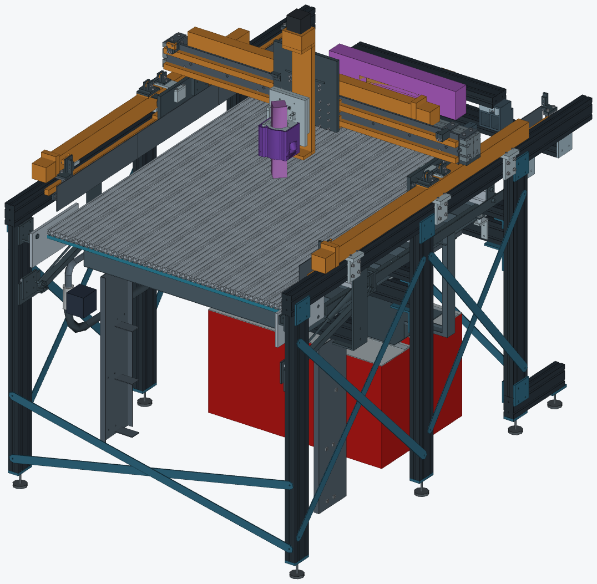
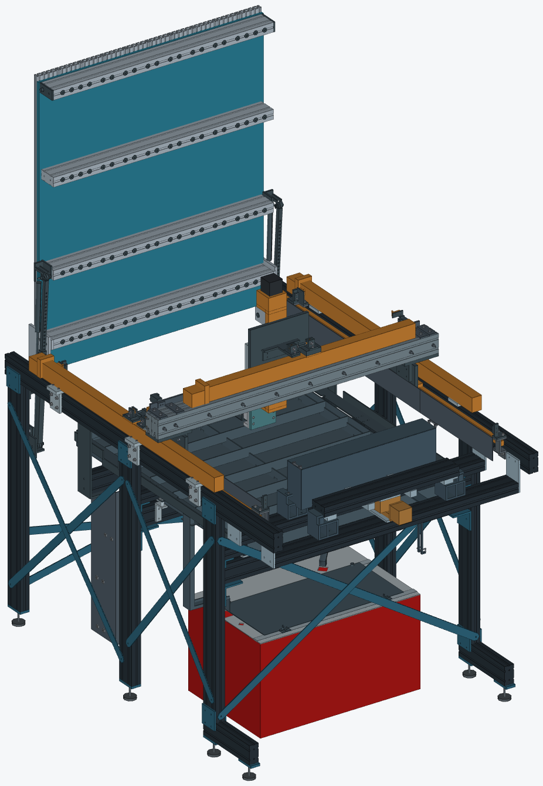

# Integrated 4080 small table

This is the current small wood/carving and plasma design. It integrates the
owner's original clamp/boot geometry, full HDPE/20100 bed, owned 300 mm Z and
selected 200 mm magazine slide into one source assembly. It supersedes the
provisional heads, plywood cassettes and separate belt magazine proposals.
**It is a review model, not a released fabrication, CAM or operating package.**

- [Wood mode STEP](output/INTEGRATED_4080_SMALL_WOOD.step)
- [Plasma mode STEP](output/INTEGRATED_4080_SMALL_PLASMA.step)
- [Changeover at 45 degrees STEP](output/INTEGRATED_4080_SMALL_CHANGEOVER.step)
- [Printable current review](../../output/pdf/plasma-router-stand-integrated-4080-review.pdf)
- [Current status and unresolved requirements](STATUS.md)
- [Stock, hardware, ownership and budget](manufacturing/README.md)
- [Assembly source and independent STEP readback](output/assembly-check.json)
- [Subsystem clearance check](output/integration-clearance-check.json)

The cutting travel remains 800 mm X by 1000 mm Y. The owned Z has 300 mm
catalogue travel; this design assesses a 250 mm working domain. No controller
limits or steps-per-mm settings have been changed. The complete machine is
not qualified for steel milling.

The six-post frame uses 4080, with continuous 1760 mm headers from Y-160 to
Y1600. The front posts move to Y-100 to support the bed's parking bay. Two
1250 mm 4080 gantry profiles replace the former 8080 beam, with ten sleeved
couplers, a continuous 1200 by 112 by 6.35 mm steel rail face with fitted rear
lands, and four 32 by 80 by 6.35 mm top bridges. The existing lower brackets
remain. The steel face replaces the two aluminum guide strips and preserves
the rail datum stack; actual rail holes are transferred from the owned rails.
Its welds, joint slip and load sharing still require qualification.

The 1000 by 1220 mm track bed uses ten finished 1220 mm 20100 profiles above one
1000 by 1200 by 12.7 mm drill-only HDPE sheet. Four 980 mm 4080 crossbearers stand
80 mm high by 40 mm along Y, at Y110/395/780/1140. The work surface remains
Z967.8. Eighty 92.7 mm metal columns bypass plastic preload; eighty 18OD/6.4ID
by 1.6 mm bridge washers complete the metal bearing path. Purchase eighty
M5x100 screws and finish them to 99.3 +/-0.1 mm under the head. Actual
extrusion/nut fit, bearing and preload capacity remain qualification gates.

The ideal 100 N bed component screen improves from 0.296 to 0.156 mm displacement,
using assumed strong-axis I 536000 mm^4 and no HDPE composite credit. At 50% of
that section property it gives 0.203 mm. These are conditional component
calculations; drilled-section properties, joints and the full tool-to-work
loop are unqualified. Nominal moving-deck mass is 49.25-53.64 kg across the
three assumed 4080 material-area cases. The [comparison report](optimization/comparison.json)
binds the saved component cases and dated source-cost arithmetic.

Front hinges, rear drawdowns and fitted steel side receivers support the bed.
The two gas-spring candidates are now 150 lb/667 N each; required eye dimensions
are compressed no longer than 445 mm and expanded at least 700 mm. The modeled
operating distance is 456.18-658.29 mm. A specific received pair and its force
curve remain unqualified. Separate pinned telescoping stays support the
upright state. The bed parks within the permanent front bay, with its highest
nominal point approximately Z2247.8. Its track faces span Y-40 to 1180.

The complete front stop assemblies retain their cutting-mode geometry. For
bed changeover they are manually parked 400 mm rearward using the same header
slots, with fixed datum blocks for return. Gantry motion remains disabled
until they are refitted. Guide sections are stored before moving the stops;
the stops are refitted before restoring the guides. The complete head/tool
module is removed, with the common Z parked at Y1275, X975 and lift 250.
Its supported handling and off-axis parking remain a separate qualification.

The exact owner clamp and boot STEP bodies stay unchanged. A 146 by 175 by
12.7 mm billet head plate removes as a complete module from the shared dock.
The fixed 146 by 132 mm receiver retains the raised output contact while
clearing the bed's tilt arc. A matching plasma plate and splice reuse the
existing float/breakaway mechanism. The actual working boot registration and
spindle nose datum remain unencoded; a purple family cylinder is context.
One 9.525 by 20 by 110 mm side rib now stiffens the router plate using unused
owned three-eighth-inch stock, three M4x25 screws and two ground 4 x 20 mm dowels.
It clears the supplied boot body by 7.75 mm in X for any vertical home and
the full 50 mm boot stroke. The hole-aware ideal composite bending screen
falls from 0.250 to 0.093 mm at 100 N with 50 mm tool projection. Actual bolt
preload, dowel fit, joint slip, torsion and alloy remain qualification gates.

All eight bed support/hinge pins now have explicit retention geometry and
drawings. Four stay pivots and two full-open locks use M6 DIN937 low nuts and
1.6 x 14 mm split pins. The two plain 12 mm front hinge pins face inboard and
use outside custom washers and 2 x 16 mm split pins; they require no M8 nuts.
One new three-quarter-inch by 12-inch steel bar supplies all eight pins and
four hinge rings through a 303 mm nested cut plan. This is new stock.

The magazine parks in the rear bay on the selected 311 mm overall / 200 mm
travel SFU1605 stage. Integral billet tongues enter passive steel capture
roofs/guides at both endpoints; the slide deploys and retracts without manual
endpoint fasteners or another lock actuator. The original 60 mm-width
manufacturer four-pocket housing, pocket XY axes and mounting pattern are
integrated without scaling. Two 28 by 242 by 25.4 mm billet arms use the
existing 600 mm 4080 carrier. Purple volumes remain capacity allocations for
tool/kit clearance. Actual ER11 sockets, nut engagement, IR/cables, received
revision, powered axial holding force and controller interlocks still require
qualification. A removable steel cover, retained by two short M4x6 service
screws, protects the parked magazine during plasma mode.

The pan bears at Y300/630/1180 and is 26 mm lower, including the slats, drain
and keeper stations. Slat tops are Z852; the wood datum is unchanged. The
front bearer hangs from the headers on welded steel seats. Its conservative
full-brim rib/floor screen is 1.156 mm without composite flange credit, with
ideal supports and no thermal/weld-distortion qualification.

The atmospheric receiver retains a 19 mm return air gap. The upper overflow
uses one 44 by 383 mm back and two 18.1 by 383 mm sides, all 1.9 mm steel; the lower
gutter/deflector stays at its original height. Six removable guide screens
and their clips/racks now have explicit welded flat-stock drawings and exact
assembled-union proofs. The motorized gravity drain, receiver capacity,
actual valve fittings, module wipers/bellows and controller interlocks still
require physical qualification.

## Budget result

The USD 1000 complete new-parts delivered cap **does not pass**. The
5 November 2026 selected-source observations give $342.97 for ten tracks, $191.86 for one 48 by 48 by 1/2-inch
HDPE sheet and $400 for the Basic four-pocket ATC: **$934.83 core goods**.
The dated partial carts contain $455.05, including those same tracks. Counting
that overlap once gives **$1046.91 core plus staged hardware**, before the
frame, pan, remaining parts, freight and tax. The required $50 tool setter
brings that known subset to $1096.91. No complete delivered quote is verified.

The track order is two actual four-profile 1500 mm packs cut to 1220 plus one
actual two-profile 1220 mm pack. The 1500 mm packs show **December 9-24 delivery**
in the cart; the earlier November estimate is superseded. Amazon shows free
Prime to 30510 for the selected lines. HDPE freight and all tax are unknown;
AliExpress's displayed free shipping has not been confirmed against the exact
Alto address. These are dated selected-source observations, not a market minimum.

Known owned equipment and the two declared aluminum sheets are excluded.
The two sheets have 14 exclusive blanks: ten from the half-inch sheet and
four from the three-eighth-inch sheet. No plate is credited twice. Tracks,
the full HDPE sheet and RapidChange kit have no established ownership credit.
See the [price register](manufacturing/price-and-budget-register.json), with
source links, unknown charges and new-material requirements kept explicit.
The [selected AliExpress cart evidence](manufacturing/selected-cart-evidence.json)
records 16 selected variants /33 packs /538 pieces across AliExpress and
Amazon. It is a partial cart,
not the complete BOM, a purchase, or a complete delivered build quote.

## Reproduce and review

Use the existing CadQuery interpreter. Run `mechanical.py`, the selected head
builders, `atc/build_atc.py`, `bed/build_bed.py --local`, the bed drill/takeoff
helpers, `utilities/build_utilities.py`, the two guide routes and front-stop
transfer check, then `bed/check_machine_changeover.py` and `check_integration.py`.
Run `assembly.py`, followed by `verify_assembly_outputs.py` for adaptive mass
readback and complete fitted-camera previews; then regenerate the manufacturing
pack. The older standalone nonlocal bed builder does not represent the current
parked-stop/common-dock changeover context. Reports bind their inputs by SHA-256
and state their scope. A successful
STEP readback proves valid exported solids, not a working machine. Use the
current status file to distinguish geometric checks, actual-interface holds,
physical qualification and the failed delivered-budget requirement.
