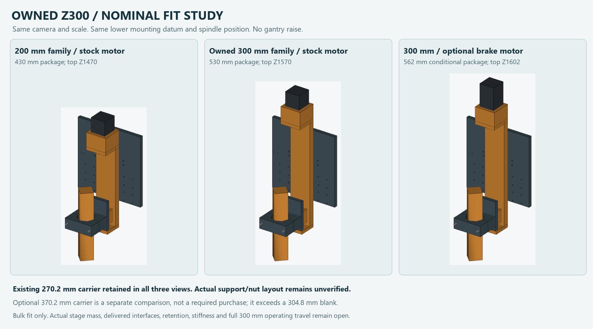

# Owned RATTMMOTOR ZBX80 — 300 mm travel

**Not a finished machine: [current status and remaining design work](STATUS.md).**
The supplied owner clamp/powered boot and full drill-only HDPE/20100 bed are
not yet represented by this provisional head/cassette layout. The previously
selected magazine slide also needs explicit integration/disposition. Read the
[recovered head note](OWNER-HEAD-INTEGRATION.md) before using any tooling files.

The owner's September 30 purchase register already identifies **RATTMMOTOR
ZBX80, 300 mm travel**. That record was in the other project copy and has now
been recovered. The model family is known; it does not need to be supplied again.
The proposed new 200 mm Z purchase remains on hold.

[Recovered product evidence](owned-hardware-evidence.json) preserves the
original source identities, primary variation map and current supplier facts.
The matching [300 mm family listing](https://www.amazon.com/dp/B09MY7XP9L)
states **419 mm base length, 530 mm overall including the stock motor, and
80 mm width**. These are published nominal dimensions, not inspection of the
delivered unit. The receipt ASIN/revision and exact mounting interfaces remain
unmeasured. The 100 mm drawings are not used as a 300 mm drilling template.

The frozen XR2 assemblies still represent the 200 mm candidate. A separate
300 mm head-envelope study assesses reuse against that layout; it does not
replace the all-4080 frame with the older steel-frame architecture or transfer
old machine checks to new geometry.

## Current ATC stroke case

With the current nominal spindle reference at Z970, magazine base at Z1030.15,
80 mm accepted kit height, 50 mm loaded-tool projection and 5 mm running gap:

`required lift = 1030.15 + 80 + 50 + 5 - 970 = 195.15 mm`.

A full 300 mm stroke would give a nominal 109.85 mm flyover gap **if the same
mounted reference datums apply**. The spindle reference is not a measured nut
plane. Actual pockets and tooling remain separate supplier interfaces.

## Fit and rigidity

The selected bulk-fit study passes for the nominal 300 mm stock-motor envelope
over the existing **800 X / 1000 Y / 200 mm assessed working range**. It proposes
no gantry raise and retains the 270.2 mm carrier outer height. The stock-motor
module reaches model Z1570: 100 mm above the 200 mm stock-motor comparison and
68 mm above XR2's conditional brake-motor package. Actual unit mass and guide
loads still need verification.

The image compares outer envelopes before the custom-joint repair described
below. Use the proposal assemblies and repaired part files for those details.

## Current review revision and evidence

- [Latest full woodworking review](output/proposal-assemblies-v2/Z300_WORK200_JOINT_AND_STOP_REPAIRED_REVIEW_WOOD.step)
- [Latest full plasma review](output/proposal-assemblies-v2/Z300_WORK200_JOINT_AND_STOP_REPAIRED_REVIEW_PLASMA.step)
- [Latest assembly export, interface and source checks](output/proposal-assemblies-v2/candidate-assembly-v2-check.json)
- [Scoped motion proof and contact dispositions](MOTION-PROOF.md)
- [Current candidate conversion and service proof](PATH-SERVICE-PROOF.md)
- [Unpriced manufacturing takeoff and holds](manufacturing/README.md)
- [Selected bulk-fit decision](output/z300-fit-decision.json)
- [Two-part repair check](output/custom-joint-repair-check.json)
- [Machining detail and limits](RELIEF-DETAIL.md)
- [Repaired carrier STEP](output/Z_CARRIER_RELIEVED_CANDIDATE.step)
- [Revised integral support STEP](output/X_LINK_SUPPORT_D37_CANDIDATE.step)
- [Repaired stock-Z300 head](output/Z300_STOCK_HEAD_REPAIRED_CUSTOM_JOINT.step)
- [Candidate requirements and ownership](candidate-requirements.json)

The fit check exposed two inherited custom-part defects: 12,580.62 mm3 of
carrier/flange interference and lower M6 support holes breaking through the
downstand edge. The new candidate has a bearing-floor through-relief and a
37 mm integral downstand. Its carrier blank remains unchanged. The larger
support billet remains new/unverified stock; no owned-stock credit is assumed.

The latest revision also relieves the two front Y-stop bases around the
conservative motor-bracket envelope. The matched forward clearance/tap axes
and screws move from Y90 to Y105. Full head seats and landing material remain;
the exact nominal gap is 0.5 mm. Reduced 35 mm bolt spacing, actual bracket
dimensions and stop-load capacity remain qualification items. Earlier proposal
assemblies are retained in `output/proposal-assemblies` as superseded evidence.

The raw all-candidate study preserves its failed whole-part screen for the
unneeded taller carrier. Exact comparison shows that interference was already
present in the lower joint. The selected bulk-fit decision distinguishes that
finding from new module bulk, and the separate repair check verifies the
corrected joint. Existing XR2 files remain unchanged as historical evidence.

Reproduce with CadQuery Python: `z300_fit_study.py`,
`verify_extension_contact.py`, `fit_decision.py`, `custom_joint_repair.py`, then
`export_candidate_assembly.py` for the earlier two-part revision. The latest
review uses `front_stop_repair.py`, the shared `candidate_motion_factory.py`,
the scoped motion/path checkers and `export_review_revision.py`.
The raw all-candidate study intentionally
returns nonzero for its retained custom-joint finding; inspect the selected
decision and the repair report rather than treating it as a new Z300 clash.

## Remaining qualification

Keep the existing gantry height and spindle offset as the starting layout.
Assess the longer fixed body, mounting support, head mass, guide reactions,
power-off retention and all affected travel/ATC paths. A commanded travel limit
does not shorten the physical module or remove its mass and overhang.

The manufacturer family and owned stroke are established by the recovered
records. Exact delivered fits, lead calibration and physical stiffness still
require their normal verification; no operating or fabrication release follows
from the advertised stroke alone.
