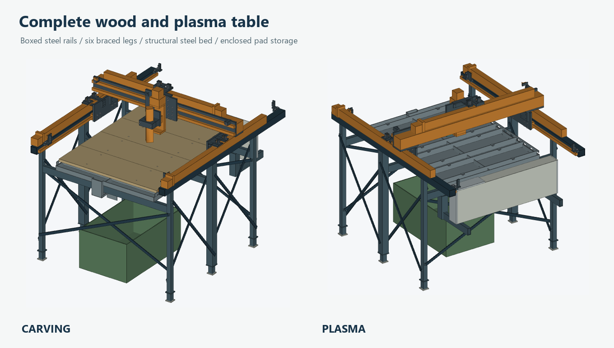

# Complete carving and plasma table under USD 600

This design prices the whole stationary table for the small machine with 800 × 1,000 mm nominal XY travel. It uses six fixed, shimmed steel feet and welded construction. The owner's motion hardware, cutter, compressor, aluminum blanks, fabrication tools and labor are carried forward.

**Estimated delivered total to Alto, Georgia is $599.03**, including estimated sales tax and a $10 pretax allowance for fabrication consumables.

## Complete budget

| Purchase | Goods | Shipping | Estimated tax | Delivered |
|---|---:|---:|---:|---:|
| Al-Win steel for frame, feet, pan, slats, combs, braces and small plates | $260.31 | $166.00 | $29.84 | $456.15 |
| IKEA wood shelf blanks and 34 L cold-water receiver | $43.99 | $14.00 | $4.06 | $62.05 |
| BoltsAndNuts mechanical fasteners | $30.74 | $0.00 | $2.15 | $32.89 |
| Eastman siphon hose through eBay | $10.81 | $0.00 | $0.76 | $11.57 |
| Cold storage sheet through eBay | $23.99 | $0.00 | $1.68 | $25.67 |
| Fabrication consumables allowance | $10.00 | $0.00 | $0.70 | $10.70 |
| **Complete planning total** | **$379.84** | **$180.00** | **$39.19** | **$599.03** |

The materials total is $588.33 with estimated tax. The consumables allowance adds $10.70. The ceiling has $0.97 remaining.

Steel and fastener freight was returned by merchant calculators for the supplied delivery address. IKEA returned a guest delivery and tax estimate for ZIP 30510. The two eBay sellers advertise free US delivery. Their destination checkout totals remain unverified. The $10 consumables line is a planning allowance. These prices do not establish a fixed supplier contract or guarantee future availability.

The quote covers the pan, eight steel slats, four wood pads, closed storage case, receiver, drain hose and all listed table hardware. The feet have welded bearing pads and steel leveling shims. Water and panel changes are manual. The planned machine is for carving, woodworking and compatible mild-steel plasma work. Actual plasma start, torch, electrical and fume integration still require their own checks.

## Material and load choices

Two continuous 50.8 mm square steel beams support the motion modules and carry the HGR guides on their inside faces. Their 1,450 mm lengths come from two 8-foot bars. The drops supply the two middle legs. Four smaller legs, six hollow foot standoffs and twelve steel bearing plates complete the six supports. The large solid rail caps and the aluminum frame profiles are removed from this version.

Three 25.4 × 50.8 mm transverse steel beams support the wet bed. Two short pieces of the same section connect them along the centerline. Twelve tension straps triangulate the side bays and both ends. Layered steel pads provide real bearing where the larger middle posts meet smaller corner posts. Raised side brace anchors clear the pan beams. [Frame calculations](structure/FRAME.md)

The pan is a shallow 830 × 1,030 mm tray in nominal 1.8974 mm steel. It has an unbroken floor, three welded combs and eight 40 mm tall slats. The slats are welded into the structural grid. They require grinding and replacement as plasma cutting consumes them. This operation is followed by a wood-bed datum check.

Four 826 × 250 mm wood pads clamp onto the same grid. The nominal shelf material is 19.05 mm particleboard with melamine faces. Each pad has four M5 hold-downs. Holes, screw heads and steel below the pads are CAM keep-out areas. Material size, effective load spreading, moisture and damage affect stiffness. The paid blanks are two IKEA UTRUSTA shelves, cut in pairs. [Board and steel contact model](structure/PLATE.md)

The nominal contact calculation predicts about 0.19 mm of work-side movement under a 100 N load. It models the wood plates, slats, combs, frame beams and four clamps per pad. The reduced-property board case is slightly more flexible. Guide, spindle, joint and floor movement are additional. The assembled machine needs a loaded indicator test before machining accuracy is claimed.

## Water and bed changes

Normal water depth is 20 mm. The front overflow crest is 26 mm above the inside floor. The retaining wall limits gross water to 28.30 L before subtracting steel displacement. One litre of hose allowance brings the conservative inventory to 29.30 L. The actual receiver must demonstrate at least 30 L usable capacity while standing on the floor. Its nominal rating is 34 L. Keep it vented and supported, and empty it before each drain.

A welded overflow collector drops ahead of the front frame member, returns underneath it and ends in a downward deflector above the receiver. Verify overflow flow, splash capture, blockage and heat exposure with the actual equipment. The polypropylene tub is for cooled water. Its heat protection requires an as-built test. The manual clear hose is primed by immersion with tools off and water cooled. Keep its inlet pointing downward just above the floor, then wipe remaining water and sludge before wood work. No pressure vessel is part of this design.

The pads stand on their long edges in a closed sheet-metal case in the rear bay. The case has steel skins and uses the owned 9.525 mm aluminum for both endcaps and the roof patch. It is a secondary enclosure for clean, dry panels outside the cutting rectangle. Keep the lid secured for plasma and verify actual shielding and dust isolation.

For a change, remove the cutter, park the gantry at Y275 with X575 and Z lift 100, remove the lid and undo the pad clamps. Lift each horizontal pad to a bottom height of Z850, translate it above the rear case, raise it to Z950, rotate it upright about its center and lower it into its assigned slot. Restore the wood setup in reverse order. All four pads remain within the 1,150 × 1,450 mm review footprint. Hands, flexible leads, lifting practice and actual clearances need a physical dry run. [Transfer and water evidence](wetdry-validation.json)

## Sources and review files

- [Al-Win raw steel](https://alwinmetals.com/) and [detailed merchant basket](sourcing/final-steel-five-braces.json)
- [IKEA UTRUSTA shelf pair](https://www.ikea.com/us/en/p/utrusta-shelf-white-80265534/) and [TORKIS receiver](https://www.ikea.com/us/en/p/torkis-flexible-laundry-basket-in-outdoor-green-20579165/)
- [Priced fastener basket with primary item URLs](sourcing/final-hardware-16-clamps.json)
- [Eastman hose](https://www.ebay.com/itm/307183407160) and [storage sheet](https://www.ebay.com/itm/317127364211)
- [Detailed total and delivery assumptions](sourcing/final-build-rollup.json) and [raw-stock nesting](sourcing/frame-cutplan-final.json)
- [Carving STEP](review/CARVING.step), [plasma STEP](review/PLASMA.step), [solid and intersection checks](review/geometry.json) and [motion check](review/motion-check.json)

The thick-stock nest includes 3 mm saw kerf and 2 mm sheet edge margins. The pan sheet has only 1.2 mm of nominal width surplus. The thin storage skin uses tin snips and factory edges. Its nominal 84.4 mm roof remnant has only 0.4 mm width surplus for the 84 mm roof piece. Measure both delivered sheets before cutting. Establish bend deduction and radii on the actual sheet and forming tools.

The geometry is a costed engineering review. Physical module mounting holes and screw grip lengths remain to be transferred from the actual parts. The selected tube sellers specify gauges without a guaranteed measured wall. Measure sections, verify welds and foot contact, establish rail flatness after welding, and qualify the final tool-to-work loop before fabrication release and production CAM.
